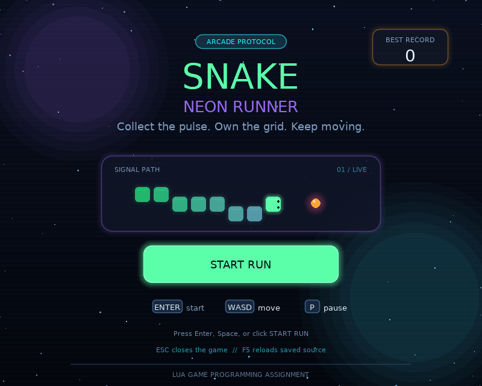
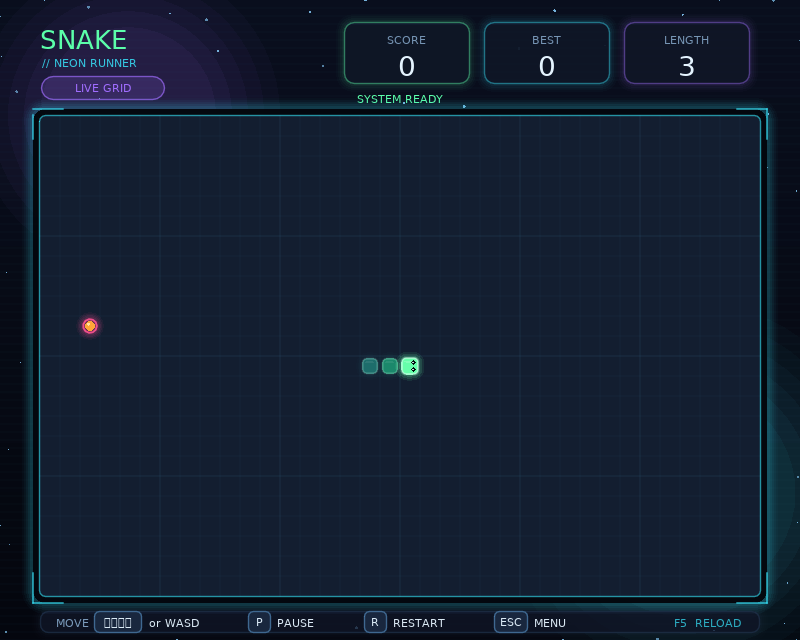

# Snake: Neon Runner — Lua Game Programming Assignment

## Publish on Cloudflare Pages with GitHub

This download includes a prebuilt browser version in **`web/`**. See
**[DEPLOY_AR.md](DEPLOY_AR.md)** for the complete Arabic walkthrough.

Upload the contents of this project folder to your GitHub repository, then
connect it through **Cloudflare Pages → Connect to Git** with these settings:

| Setting | Value |
| --- | --- |
| Production branch | `main` |
| Framework preset | None |
| Build command | `exit 0` |
| Build output directory | `web` |
| Root directory | Leave blank |

No local installation is needed for this first deployment. After future Lua
changes, rebuild `web/` using `node scripts/build-web.mjs` (requires Node.js and
the `zip` command), then commit the new web files along with your Lua source.
Cloudflare will publish committed web files automatically; `exit 0` does not
recompile Lua. This bundle is prepared for deployment, not already published.

The browser build uses the same Lua game through the love.js compatibility
runtime, pinned to upstream commit
`c4f04e185033a7c9fbefa9be3bec88c41a90421b`. It adds a browser loader and
fullscreen control. The native Lua 5.4 `<close>` implementation remains part of
the assignment source; the browser uses the compatible persistence backend.

The bundle was built and statically checked, but its final browser interaction
test must be performed after deployment. The game currently requires a keyboard.

---

A polished, modular Snake game for **LOVE 11.5**. It keeps every assignment
requirement while presenting the game as a neon-arcade experience built entirely
with LOVE shapes: no downloaded images, fonts, sound, or external libraries.

## Run on macOS

1. Install [LOVE](https://love2d.org/) and move it to Applications.
2. After extracting the download, drag the **`Snake_Neon_Runner_DEPLOY` folder** itself onto LOVE. It contains `main.lua` at its top level.
3. Or open that folder in Cursor and run this in its terminal:

```sh
/Applications/love.app/Contents/MacOS/love .
```

`run_mac.command` is an optional launcher. The included `Snake.love` archive is
also runnable by dragging it onto LOVE. Do not drag the outer ZIP file or a folder
that only contains `Snake_Neon_Runner_DEPLOY`; LOVE needs a folder where `main.lua` is
directly inside it.

## Preview





## Controls

| Key | Action |
| --- | --- |
| Enter / Space / START RUN | Begin a round |
| Arrow keys / WASD | Change direction |
| P | Pause or resume |
| R | Start a new round |
| Esc while playing | Return to the menu |
| Esc in the menu | Quit |
| F5 | Reload saved source code |

The game pauses automatically when its window loses focus.

## Assignment checklist

| Assignment requirement | Where it is implemented |
| --- | --- |
| Class-style Menu/Playing state manager with `new`, `switch`, `update`, `draw` | `gamestate.lua`, `states/menu_state.lua`, `states/game_state.lua` |
| Entity with `addComponent`, `getComponent`, `hasComponent` | `entity.lua` |
| Position, Movement, Renderer components used by gameplay | `snake_game.lua` |
| Vector class with `__add`, `__eq`, `__tostring` | `vector2.lua` |
| Continuous movement, food, score, growth, wall/self collision | `snake_game.lua` |
| Command Pattern, key-to-function binding | `input.lua`, used in both state files |
| Persistent high score | `highscore.lua`, `highscore54.lua` |
| Lua 5.4 `<close>` modern feature | `highscore54.lua` |
| Observer Pattern bonus | `events.lua`, used for food, loss, and win effects |
| Extra visual layer | `theme.lua`, `effects.lua` |

## Source structure

| File | Responsibility |
| --- | --- |
| `main.lua` | LOVE callbacks, fonts, stars, and application startup |
| `conf.lua` | Window title, size, and save-directory identity |
| `gamestate.lua` | Creates states and dispatches input/update/draw calls |
| `states/menu_state.lua` | Animated title screen, start command, mouse button |
| `states/game_state.lua` | Commands, HUD, overlays, screen shake, particle feedback |
| `snake_game.lua` | Snake rules, components, continuous movement, and board drawing |
| `theme.lua` | Shared neon color system, panels, glow, keycaps, background |
| `effects.lua` | Visual-only particles and shockwaves |
| `entity.lua` | Component storage API |
| `vector2.lua` | Position/vector operators |
| `input.lua` | Command Pattern input map |
| `events.lua` | Observer Pattern event bus |
| `highscore.lua` | Validated score persistence and runtime selection |
| `highscore54.lua` | Native Lua 5.4 `<close>` resource-management backend |
| `tests/run.lua` | Lua-only regression checks |

`theme.lua` and `effects.lua` have no authority over rules or score. This keeps
the assignment logic isolated: `snake_game.lua` remains responsible for movement,
food, growth, collision, and winning; the state layer decides how events look.

## Lua 5.4 and LOVE compatibility

The assignment combines LOVE callbacks with a Lua 5.4-only syntax feature.
Ordinary LOVE 11.5 uses LuaJIT, whose language is based on Lua 5.1, so it cannot
parse `local file <close>`.

This project supports both environments honestly:

1. `highscore54.lua` contains the real Lua 5.4 `<close>` implementation. It
   closes a file when its scope ends, including after a write error.
2. `highscore.lua` detects support. In ordinary LOVE it uses `love.filesystem`,
   allowing the graphical game to run normally without parsing the 5.4-only file.

The native `<close>` code is tested with Lua 5.4. To execute that exact code inside
the graphical game, LOVE itself would need to be built with Lua 5.4. Keep this
explanation with the assignment submission.

High scores are stored beneath LOVE's save directory as `scores/highscore.txt`.
The stable save identity is `snake_lua_assignment`. On macOS that is normally:

```text
~/Library/Application Support/LOVE/snake_lua_assignment/scores/highscore.txt
```

## Validation

From the source directory, when Lua 5.4 or LuaJIT is available:

```sh
lua5.4 tests/run.lua
luajit tests/run.lua
```

The suite checks vectors, components, commands, events, movement timing, rapid
turn rejection, food, growth, all walls, self collision, legal tail-vacating
movement, victory, pause, persistence, malformed scores, storage errors, state
flow, and the Lua 5.4 auto-close path. The current project passes **32 checks on
Lua 5.4** and **32 checks on LuaJIT**. It was also exercised in LOVE 11.5 with the
actual production entry point, menu, keyboard input, focus-pause, restart, mouse
start, and drawing.

## Submission

Upload all files from the extracted `Snake_Neon_Runner_DEPLOY` project folder to your own GitHub repository.
Keep the `states`, `tests`, and `docs` folders. Do not submit only `Snake.love`;
the assignment needs the source code. Do not upload personal saved score files.

Use your real GitHub repository URL in the assignment. The modern-feature comment
is at the top of `highscore54.lua`; the Observer bonus is both implemented and used.

## References

- [LOVE](https://love2d.org/)
- [LOVE save directory](https://love2d.org/wiki/love.filesystem.getSaveDirectory)
- [LuaJIT language compatibility](https://luajit.org/extensions.html)
- [Lua 5.4 to-be-closed variables](https://www.lua.org/manual/5.4/manual.html#3.3.8)
